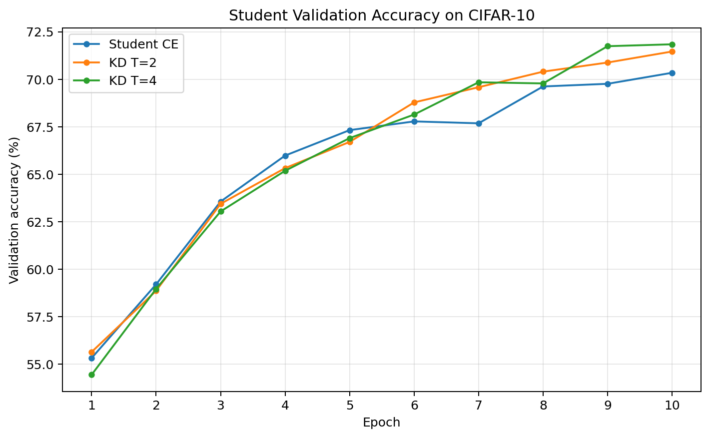

# KD：基于 PyTorch 教程的知识蒸馏学习实验

这是我完成的第一个 GitHub 机器学习学习项目。
项目以 CIFAR-10 图像分类为练习任务，理解教师—学生训练，
并比较普通监督学习与不同温度下的输出知识蒸馏。

## 参考与个人实践

模型结构和输出蒸馏方法参考
[PyTorch 官方知识蒸馏教程](https://docs.pytorch.org/tutorials/beginner/knowledge_distillation_tutorial.html)。

本项目保留官方 DeepNN 教师和 LightNN 学生结构。
个人实践主要包括：

- 从原训练集中分层划出验证集。
- 为所有学生使用相同初始权重和数据打乱起点。
- 比较 T=2、T=4，并根据验证准确率选择温度。
- 保存最佳模型、逐轮记录和最终测试结果。

本项目属于教程复现与小规模对照实验，不提出新的蒸馏算法。

## 实验设置

- 数据：完整 CIFAR-10。
- 划分：45,000 张训练、5,000 张验证、10,000 张测试。
- 验证集：从原训练集每类固定抽取 500 张。
- 预处理：沿用官方教程的 ToTensor 与归一化，不使用数据增强。
- 随机种子：42。
- 环境：Google Colab，Tesla T4 GPU。
- Batch size：128。
- 优化器：Adam，学习率 0.001。
- 每组训练：10 个 epoch。
- 教师和普通学生：交叉熵。
- 蒸馏学生：0.75 × CE + 0.25 × T² × KL。
- 每组模型均按最高验证准确率保存权重。

蒸馏时固定教师，分别训练两个全新的学生，
没有在普通学生训练后的权重上继续训练。

## 验证集温度比较

| 学生训练方式 | 最佳验证准确率 |
|---|---:|
| Student CE | 70.34% |
| KD T=2 | 71.46% |
| KD T=4 | 71.84% |

根据验证准确率选择 T=4，之后不根据测试结果重新调整配置。

## 最终测试

| 模型 | 参数量 | 最佳验证准确率 | 测试准确率 |
|---|---:|---:|---:|
| Teacher | 1,186,986 | 76.20% | 74.45% |
| Student CE | 267,738 | 70.34% | 69.21% |
| Student KD T=4 | 267,738 | 71.84% | 70.66% |

T=4 蒸馏学生相对普通学生的测试准确率变化为
**+1.45 个百分点**。
正值表示提升，负值表示下降。

测试集仅用于最终评估教师、普通学生及选定的 T=4 蒸馏学生。

## 我的学习收获

- 理解卷积特征提取器与分类器的分工。
- 理解真实标签监督与教师软概率指导的区别。
- 区分训练集、验证集和测试集的用途。
- 观察到教师训练后期训练准确率继续上升，但验证表现不再改善。
- 学习通过相同起点和固定实验设置进行比较。

## 局限

结果来自一个随机种子，未进行多次重复或统计显著性检验，
不能据此断言蒸馏或 T=4 在其他条件下一定更优。
与官方教程相比，本项目增加了验证划分和最佳模型选择，
因此不能将准确率差异完全归因于算法效果。

本项目没有测量推理速度；参数更少不直接等于实测速度更快。

## 如何运行

1. 将 KD_project.ipynb 上传到 Google Colab。
2. 在“运行时 → 更改运行时类型”中选择 GPU。
3. 从上到下运行单元格，首次运行会下载 CIFAR-10。
4. 训练与结果文件保存在 /content/KD_outputs。
5. 及时下载结果，Colab 临时运行时结束后文件可能丢失。

运行时间和数值可能随硬件、软件版本及随机计算发生变化。

## 文件说明

- KD_project.ipynb：完整实验代码与输出。
- results/final_results.csv：最终测试指标。
- results/validation_accuracy.png：学生验证准确率曲线。
- results/*_history.json：逐轮训练与验证记录。

数据集并不包含在本仓库内，运行代码即可下载。
